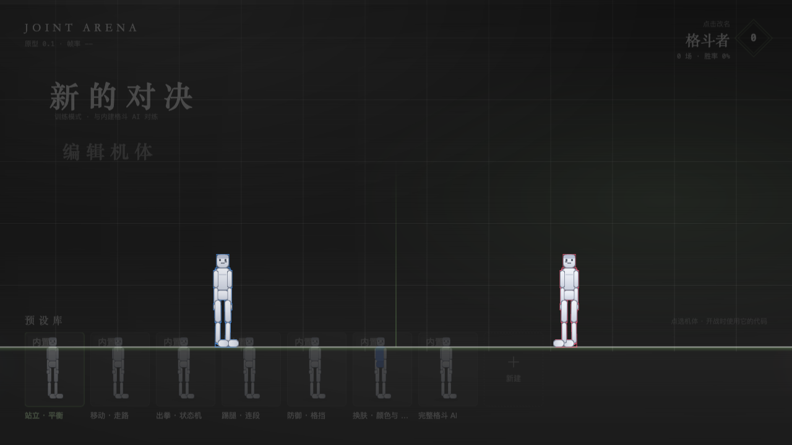
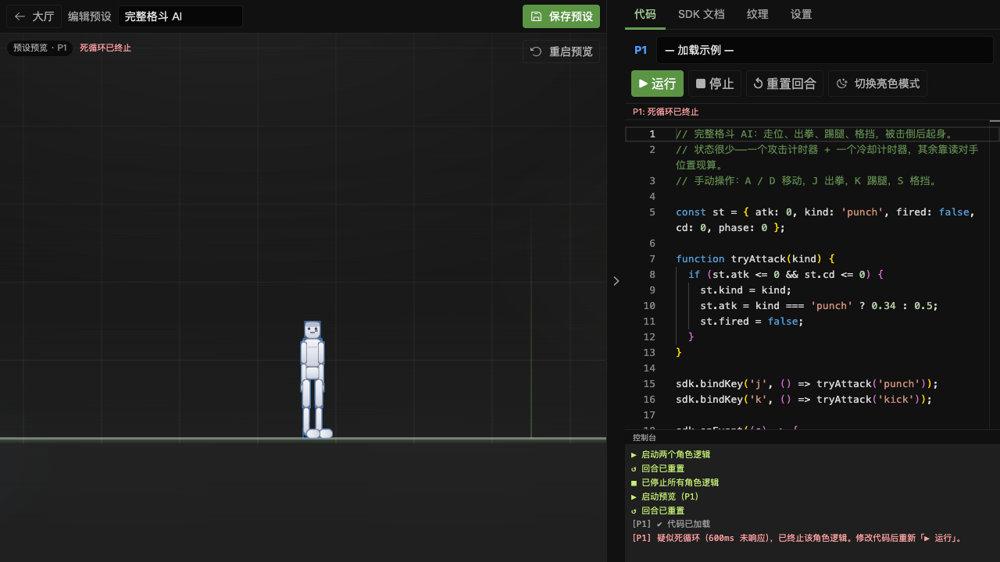
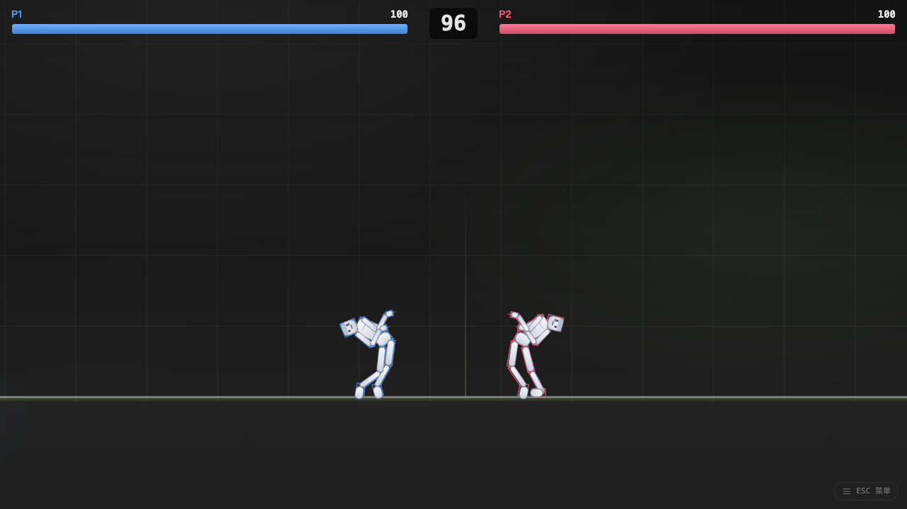
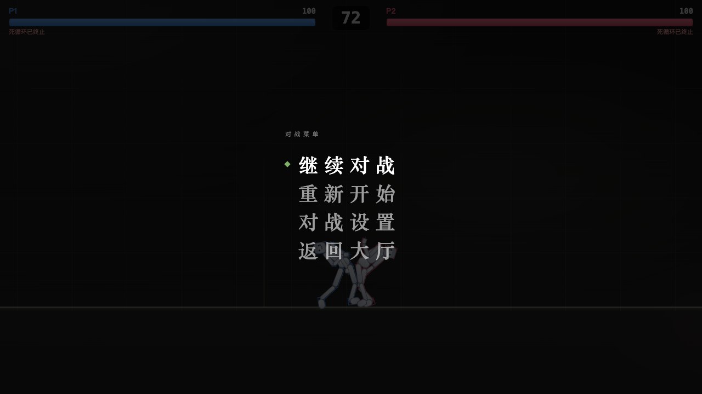

# Joint Arena — Programmable Joint Fighting Prototype

[](https://github.com/FliPPeDround/joint-arena/actions/workflows/ci.yml)
[](https://github.com/FliPPeDround/joint-arena/actions/workflows/deploy-pages.yml)
[](LICENSE)

[中文](README.md) · **English**

Joint Arena is a “programmable joint fighting” web game prototype: the fighters are whitebox skeletons, and instead of pressing buttons for preset moves you **write JavaScript that drives your character at the joint level** — 14 joints are 14 programmable servo motors, and only by coordinating them can the character stand, walk, punch, kick and guard. The flow matches most games: enter the **Lobby** (user profile + preset grid) → pick **Training** (spar the bot) or Online (not open yet) → two physics skeletons spar in the arena, and you win by draining the opponent's 100 HP within 99 seconds; you can also open the **Editor**, which previews the fighter live on the left and takes your code on the right, then save it as a preset.

> **Play online**: <https://flippedround.github.io/joint-arena/> (pushing to `main` deploys it automatically through GitHub Pages)

## Preview

All four captures below show the zh-CN interface.

| Lobby · Presets | Editor · live preview + Monaco |
| --- | --- |
|  |  |

| Battle · physics spar | Battle Menu (`ESC`) |
| --- | --- |
|  |  |


## Features

- **Game lobby**: user profile (name / record), the preset grid (one thumbnail per saved code, rendered from its own colors), and the Training / Online mode picker.
- **Live preview in the editor**: a single-fighter sandbox engine (no opponent / no damage / no countdown), so a code change shows its result right away.
- **Real physics skeleton**: 15 rigid bodies + 14 revolute joints with limits (Rapier2D), no animation frames — every motion is a physics result driven by code.
- **Web Worker sandbox**: player code runs on its own thread, so an infinite loop cannot freeze the game (a 600ms watchdog ends it); commands and logs have explicit quotas.
- **Game-level balance assist**: a built-in posture controller (tunable strength 0~1.6) holds standing hip height at 82px, upright deviation ≤1°, ≈1px drift over 6 seconds — players don't reimplement “how to stand” from scratch and can spend their effort on fight strategy.
- **Complete fight rules**: three-tier body parts (hands and feet attack / forearms and shins defend and can block fully / head, torso, hips and thighs take decreasing damage), saturating contact-force damage (capped per hit), damage numbers at the hit point, arm-raise guard (damage ×0.35), hitstun scaled by damage, capped knockback, knockdown and get-up, KO / time-out win.
- **Monaco editor**: dual P1/P2 models, IntelliSense for the SDK global (`sdk.` completions), syntax validation, and a light/dark theme that follows the system.
- **Appearance customization**: three ways to reskin — tint / image texture / Canvas drawing — with the template spec and template PNG download built into the app.
- **7 built-in examples**: from “01 Standing · Balance” to “07 Complete fight AI”, covering state machines, combos, defense and footwork.
- **Two languages**: interface copy, status labels, the console, the SDK docs and the example code all ship in zh-CN and en-US; the language choice is stored in
  localStorage and switching applies at once (banners already on screen, HUD states and the engine hints in the console follow along). The examples exist once per
  language with logic identical line by line — only comments and `sdk.log()` text differ, so both sides run the same AI behavior.

## Tech stack

| Layer | Technology |
| --- | --- |
| Build & language | Vite 7 + TypeScript 5.9 |
| UI framework | Vue 3.5 (`<script setup>` + reactive stores) |
| Internationalization | vue-i18n 11 (`legacy: false`; the message catalog is sourced from zh-CN, and en-US keys are held in line by a type constraint) |
| Design system | `@antfu/design` (UnoCSS `presetAnthonyDesign` tokens + components) |
| Code editor | Monaco Editor 0.57 (language worker bundled by Vite, with SDK type completions) |
| Rendering | PixiJS 7.4 |
| Skeleton animation runtime | DragonBones 5.7 (patched vendored copy in `src/vendor/`; skeleton data is generated by code at runtime, no external animation assets are loaded) |
| 2D physics | Rapier2D 0.21 (WASM, `@dimforge/rapier2d-compat`) |
| Player code sandbox | Web Worker (ES module format, communicating over a message protocol) |

## Quick start

Requires **Node.js ≥ 22.20** (see `.nvmrc`) and **pnpm**.

```bash
git clone https://github.com/FliPPeDround/joint-arena.git
cd joint-arena
pnpm install
pnpm dev
```

Open **http://127.0.0.1:5173** (the Vite config pins the dev server to 127.0.0.1:5173).

> `pnpm install` triggers the `prepare` script (skills-npm), which downloads a set of AI-agent skills
> into `.agents/skills/` and symlinks them for each IDE. Those directories are already ignored by
> `.gitignore` and have nothing to do with the game; offline, skip them with `pnpm install --ignore-scripts`.

Other scripts:

```bash
pnpm build      # type check (vue-tsc) + build output
pnpm preview    # serve the build output
pnpm typecheck  # type check only
pnpm lint       # ESLint (@antfu/eslint-config)
pnpm run ci     # lint + typecheck + build in one go (same as CI)
```

### Deploying under a subpath

The build base defaults to the relative `./`, so the output can be hosted by any static server. When
deploying under a subpath (such as GitHub Pages' `/<repo>/`), inject an absolute base:

```bash
VITE_BASE=/joint-arena/ pnpm build
```

`.github/workflows/deploy-pages.yml` is set up this way already, and it also generates a `404.html` deep-link fallback page plus `.nojekyll`.

## How to play

1. **Lobby (home)**: the game opens on the user page — on the left, the profile (the name is editable; fights / wins / win rate accumulate as you spar in Training) and the **New Battle** and **Edit Fighter** entries; on the right, the **preset grid**: each card is a saved set of fighter code, and its thumbnail renders live from the `setPartColor` colors in that code. Click a card to select it; the next battle runs its code.
2. **New Battle**: in the mode picker, **Training** = spar the built-in fight AI (the 07 example) with the selected preset's code; **Online** is matches against other players and is not open yet.
3. **Editor**: entered from **Edit Fighter** or a preset card's edit button — on the left, a **live preview** of that fighter (single-fighter sandbox: no opponent, no damage, no round timer); on the right, the **Code** (typing `sdk.` brings up completions), **SDK Docs**, **Textures** and **Settings** tabs. Up top you rename the fighter and press **Save Preset** (saving a built-in example copies it into your own preset first). **Lobby** in the top-left goes back.
4. **Battle**: the full fighting stage (health bars + round timer + effects); the fast-paced match offers no code editing. The **ESC menu** button in the bottom-right (or the `ESC` key) opens the **Battle Menu**: Resume / Restart / Match settings (**Debug view** toggles, **Key bindings**) / Back to lobby. The menu does not pause the fight — the arena keeps running behind it.
5. **Writing code**: code is written in the **Editor** (P1 single-fighter preview + console) and lives in browser localStorage, so a refresh does not lose it; the Training opponent is always the built-in fight AI. Keys are defined inside player code with `sdk.bindKey` / `sdk.isKeyDown`.
6. **▶ Run / ■ Stop / ↺ Reset round** (Editor): Run starts (or restarts) the fighter logic and resets the round; Stop ends the logic; Reset round restores the skeleton, health and timer (it also recovers from a pause on error). **Restart** in the Battle Menu reloads both sides' code and resets the round.
7. **Built-in presets**: the first visit seeds 7 examples (standing / walking / punch / kick / guard / skins / complete fight AI), covering state machines, combos, defense and footwork; duplicate one in the grid and edit it.
8. **Console**: `sdk.log()` output, runtime errors and hit notices print here.
9. **Settings**: both the **Settings** tab in the Editor and **Match settings** in the Battle Menu toggle **Debug view** (**Colliders / Joints & angles / Bones / Rays**), show the **Key bindings**, and switch the interface language (中文 / English). The same language switch sits next to the wordmark in the top-left of the lobby.

## Directory layout

```
joint-arena/
├── index.html                  # Vue mount point (#app)
├── vite.config.ts              # Vue/UnoCSS plugins, pinned to 127.0.0.1:5173, ES worker, monaco/pixi chunk splitting, VITE_BASE subpath deploy
├── uno.config.ts               # presetAnthonyDesign + wind4 + icons/fonts, token-driven UI
├── eslint.config.js            # @antfu/eslint-config (antislop)
├── .github/workflows/          # CI (lint/typecheck/build) + GitHub Pages deploy
├── docs/                       # docs (quickstart / SDK / skeleton / texture) and UI screenshots in docs/images/
└── src/
    ├── main.ts                 # Vue app entry: mounts App, imports UnoCSS/reset/design-system styles
    ├── App.vue                 # top-level view shell: lobby / editor / battle switching (out-in transition)
    ├── i18n/                   # vue-i18n wiring: index.ts (locale persistence + t / message keys / DisplayMsg), messages/zh-CN.ts (source of truth), messages/en-US.ts
    ├── views/
    │   ├── LobbyView.vue       # lobby: user profile + preset grid + New Battle (mode picker modal)
    │   ├── EditorView.vue      # editor: single-fighter preview engine (solo) + Code/Docs/Textures/Settings panels
    │   └── BattleView.vue      # battle: full game canvas + HUD + Battle Menu modal, Training auto-starts the round
    ├── engine/game.ts          # game engine wiring: init, command application, snapshots, round control, solo preview, dispose, __JA test hooks
    ├── stores/
    │   ├── game.ts             # reactive store: HUD / console / status / both sides' code (persisted to localStorage)
    │   ├── profile.ts          # user profile: name + record (localStorage)
    │   ├── presets.ts          # preset CRUD / selection / built-in example seeding (localStorage)
    │   └── ui.ts               # top-level view state and navigation actions (startTraining / openEditor / goLobby)
    ├── editor/presetThumb.ts   # preset thumbnails: rest-pose whitebox skeleton + code colors rendered to canvas
    ├── monaco/                 # Monaco integration: worker bundle entry, ja-dark theme, SDK type completions, P1/P2 models
    ├── components/
    │   ├── PresetThumb.vue     # preset card thumbnail canvas
    │   ├── LanguageSwitch.vue  # language switch (中文 / English, reuses the @antfu/design ActionToggleGroup)
    │   ├── HudOverlay.vue      # health bars / round timer / status labels
    │   ├── RoundBanner.vue     # KO / win-loss banners
    │   ├── BattleMenu.vue      # Battle Menu modal (Resume / Restart / Settings / Back to lobby, opened with ESC)
    │   └── editor/             # EditorPanel (tabs), CodeTab, CodeEditor (Monaco wrapper),
    │                           # ConsolePanel, DocsTab, TextureTab, SettingsTab
    ├── editor/                 # data and pure functions: examples.ts (example picker API + botCode()/starterCode(), bodies in examples.{zh-CN,en-US}.ts),
    │                           # sdkDocs.ts + sdkDocs.{zh-CN,en-US}.ts, sdkDts.ts, texturePreview.ts
    ├── combat/combatSystem.ts  # fight rules: damage / guard / hitstun / knockback / knockdown / KO / time-out win
    ├── core/utils.ts           # angle conversion (world angle ↔ DragonBones angle), geometry helpers
    ├── input/inputSystem.ts    # keyboard and mouse capture (converted to world coordinates)
    ├── physics/                # physicsWorld.ts (Rapier world) + fighterBody.ts (15 bodies / 14 joints / motors / balance assist)
    ├── render/                 # gameApp.ts (scene/camera), fighterView.ts (physics → skeleton pose sync, skins), debugView.ts
    ├── sdk/                    # worker sandbox: protocol.ts (protocol), sandboxHost.ts (host), worker.ts, workerSdk.ts (SDK implementation), sdkError.ts (error codes)
    ├── skeleton/               # partDefs.ts (authoritative parts/joints/rest-pose definitions), whiteboxAtlas.ts (whitebox atlas), skeletonData.ts (DragonBones JSON generation)
    ├── styles/                 # global styles (domain colors / doc typography / banners and view transitions)
    ├── types/                  # DragonBones API type declarations
    └── vendor/                 # vendored DragonBones 5.7 runtime (patched ES bundle + typed facade)
```

## Architecture (Vue rewrite)

One-way data flow between the engine and the UI:

- **View flow**: `stores/ui.ts` holds the top-level view (`lobby / editor / battle`), and `App.vue` switches views with a `mode="out-in"` transition — the old view unmounts first (the engine's `dispose()` releases the worker / render loop / listeners and hands back the DOM contract ids), then the new view mounts.
- **Engine → UI**: every frame `src/engine/game.ts` writes HP / round time / status into the reactive store in `stores/game.ts`; sandbox logs and status sync write there too. Vue components only read the store to render (assigning an equal value has no side effect, so writing each frame is cheap). When a side wins, the engine sets `matchWinner` and the result accumulates into the profile in `stores/profile.ts`.
- **UI → engine**: after wiring up, the engine writes its control surface (run / stop / reset / dispose / debug toggles / part tint preview / atlas queries) into `gameApi`, and components drive the engine through it. In `createGame(canvas, { solo })`, `solo` mode renders P1 only and switches the fight rules off — that is the Editor's character preview.
- **Presets**: `stores/presets.ts` manages presets (seeding the 7 built-in examples on first visit); the preset selected in the lobby provides the P1 code for Training (P2 is always the built-in fight AI, `botCode()`); Monaco models and the `codes` store stay in sync both ways. Built-in preset names and code are content, so they re-sync automatically on language change, while user-created presets are left as they are.
- **Code editing**: one Monaco model per side (P1/P2); content changes write into the `codes` store, and a store watcher persists to localStorage; at run time the engine takes code from `codes` and feeds the sandbox.
- **Internationalization**: `src/i18n` holds the vue-i18n instance (`legacy: false`) and the `joint-arena.locale` persistence, and switching language also syncs `<html lang>` and `document.title`. `messages/zh-CN.ts` is the source of truth, and `en-US` keys are held in line by the type constraint. The status bits the engine writes into the store, the console lines and the win/lose banners carry a **message key + parameters** instead of finished strings, so the text is resolved when the template renders and retranslates instantly on switch; players' free-form `sdk.log()` text shows exactly as written. Errors from the SDK and the render layer carry only an **error code + parameters** (`SdkError` comes back to the host over the worker protocol) and the catalog produces the sentence — the worker side needs no i18n instance. The letter-spacing fix for Latin scripts lives in `styles/main.css` (`html[lang^="en"] .i18n-display`).
- **Preserved DOM contracts**: the ids `#game-wrap` (Pixi auto-sizing, present in all three views) and `#editor-panel` (the right panel of the Editor, which InputSystem uses to tell whether a keystroke came from the editor or the game) must not be renamed (only one instance exists at a time).

## Milestone map M0–M6

All milestones are implemented and verified through browser automation (black-box GUI); the UI layer has been rewritten on Vue 3 + Monaco Editor.

| Milestone | Scope | Status |
| --- | --- | --- |
| M0 | Render pipeline check: DragonBones skeleton JSON and whitebox atlas generated at runtime, `?mode=m0` sine-driven demo without physics | Done |
| M1 | Physics skeleton: Rapier 15 rigid bodies + 14 revolute joints with limits, collision groups, stable standing from the rest pose | Done |
| M2 | Physics → render sync: world y flip, angle conversion and mirror formulas, debug view (colliders/joint angles/bones/rays) | Done |
| M3 | SDK sandbox: Web Worker + message protocol, snapshot/command buffering, 500 commands per frame with log throttling, 600ms watchdog, pause on repeated errors | Done |
| M4 | Editor: Monaco dual models (P1/P2), 7 examples, console, in-app SDK docs, settings page | Done (Vue rewrite) |
| M5 | Combat system: contact-force damage formula, arm-raise guard, hitstun, knockback, knockdown/get-up, KO and time-out win, HUD and round control | Done |
| M6 | Polish: texture customization through three paths, texture template PNG download, tunable balance assist (`__JA.tune`), the complete fight AI example, end-to-end browser automation regression | Done |

## Balance assist calibration (the ground under standing and moving)

Each fighter is a pure physics ragdoll, and it stands only because of the posture controller in `BALANCE` (`src/physics/fighterBody.ts`). Its parameters **must be calibrated to body weight**, otherwise the fighter cannot stay up and every preset reads as a collapsed ragdoll:

- Total weight `m·g = 5.2kg × 2200 = 11440`. The hover spring's resting sag = `m·g / kH`, so `kH` has to be **clearly stronger** than the weight: `kH=6000` → about 2px of sag (hip height 84→82).
- The old `kH=600` with `maxFUp=11500` left only just enough headroom to carry the weight: 19px resting sag (84→65), the knee chain collapsed into a crouch, and the upright restoring force could not hold either — measured, **even the built-in locked stance drifted to 25° within 3 seconds and hip height fell to 78**, so player presets could only manage two steps with workarounds like a low center-of-gravity slide.
- After the fix: standing hip height 82px, upright deviation ≤1°, ≈1px drift over 6 seconds; while walking the hip height holds at 82 (65 before), and support-foot slip is about 15% of hip speed.

Another key detail: the hover and horizontal **damping both reference this frame's expected velocity** (`rootVelTarget`) — 0 while standing, and it steps aside as soon as the player issues `setRootVelocity`. Otherwise the damping pulls against the movement command: measured, it compressed walking distance from 208px to 9px (no forward motion) and swallowed jumps too (only 2px of lift left).

## M0 demo mode

Visit **http://127.0.0.1:5173/?mode=m0** for the M0 demo: physics and player code stay off, and both fighters are driven by sine functions over joint angles (P2 phase-shifted by 1.2s). It verifies the DragonBones render pipeline and the “physics angle → skeleton angle” sync math on their own. Normal mode (no query parameter) runs the full game loop.

## Test and automation hooks (window.__JA)

The page exposes `window.__JA` in the browser console for automation scripts and tuning experiments:

| Hook | Description |
| --- | --- |
| `run()` / `stop()` / `reset()` | Same as “▶ Run” / “■ Stop” / “↺ Reset round” |
| `pressKey(key, durationMs=120)` | Synthesizes one key press/release (e.g. `__JA.pressKey('j')`) |
| `state()` | Both fighters' hp / status / hip coordinates, time left in the round, winner |
| `physics()` | Hip position and upright deviation angle for both sides, rigid-body centers of key parts |
| `joints(id)` | One fighter's 14 joint semantic angles (degrees) + hip height `__hipY` + balance strength `__bs` |
| `jointInfo(id, joint)` | One joint: whether limits are enabled, min/max, Rapier angle and semantic angle |
| `root(id)` | Root control state: setRootVelocity target, applyRootForce, balance strength, horizontal hip velocity |
| `combat()` | Combat diagnostics: contact-pair count, max contact force, hit records |
| `tune(gains)` | Rewrites the balance assist parameters in `BALANCE` directly (e.g. `__JA.tune({ kH: 6000 })`) |
| `lab.stand()` | Stops the sandbox and locks the standard standing pose with the built-in motors (isolated experiment) |
| `lab.ragdoll()` | Clears the motors and zeroes balance (pure ragdoll) |
| `arm` | P1's DragonBones skeleton object (render-layer debugging) |
| `forceSync()` / `renderDbg(id)` | Forces a pose sync / reads sprite transforms and a pose snapshot |
| `jointProto(id)` | Lists every method name on the Rapier joint object's prototype chain |

Also: if the main loop throws, the full stack is kept in `window.__loopErr`.

## More docs

> The `docs/` files below and [CONTRIBUTING.md](CONTRIBUTING.md) are Chinese-only for now; the in-game “SDK Docs” tab ships in both languages.

- [docs/QUICKSTART.md](docs/QUICKSTART.md) — a ten-minute start: write a fighter that chases the opponent and punches
- [docs/SDK.md](docs/SDK.md) — full SDK API reference (same content as the in-game “SDK Docs” tab)
- [docs/SKELETON.md](docs/SKELETON.md) — whitebox skeleton spec (part table, joint limits, coordinate conventions)
- [docs/TEXTURE_TEMPLATE.md](docs/TEXTURE_TEMPLATE.md) — texture customization guide and template spec
- [CONTRIBUTING.md](CONTRIBUTING.md) — environment requirements, pre-commit checks, code conventions and a directory tour

## License

[MIT](LICENSE) © FliPPeDround

All third-party dependencies are permissively licensed: Rapier2D (Apache-2.0), PixiJS / DragonBones / Monaco / Vue (MIT).
`src/vendor/dragonBones.esm.js` is a patched ESM build of `pixi-dragonbones@5.7.0-1`, with its license header kept in the file.
